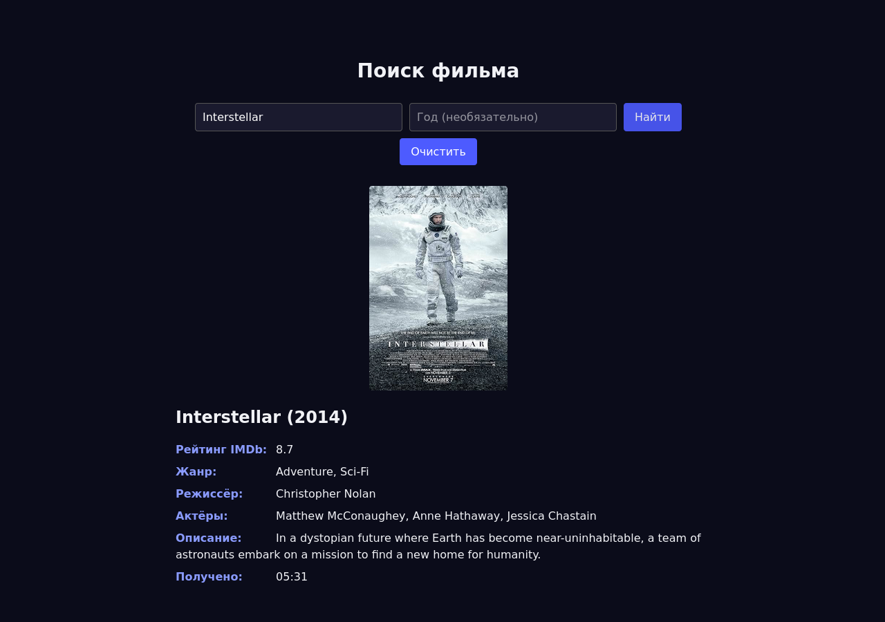

# CineScope

Веб-приложение для поиска информации о фильмах: клиент отправляет название, сервер
обращается к внешнему API OMDb и возвращает карточку фильма с рейтингом IMDb, жанром,
режиссёром, актёрами и описанием.



## Стек

| Слой | Технологии |
| --- | --- |
| Сервер | Node.js, Express 5, axios, cors, dotenv |
| Клиент | Vue 3 (Options API), Vite 7, axios |
| Внешний сервис | [OMDb API](https://www.omdbapi.com/) |
| Тесты | встроенный модуль `node:test`, без сторонних библиотек |

## Структура

```
cinescope/
├── backend/
│   ├── server.js           # Express-сервер: GET /api/movie, раздача собранного клиента
│   ├── test/api.test.js    # проверки HTTP-контракта
│   ├── .env.example        # шаблон переменных окружения
│   └── package.json
├── frontend/
│   ├── src/
│   │   ├── components/MovieSearch.vue   # форма поиска и карточка результата
│   │   ├── App.vue
│   │   ├── index.css
│   │   └── main.js
│   ├── index.html
│   └── vite.config.js
├── docs/
│   ├── Техническое-задание.md
│   └── screenshot.png
└── README.md
```

## Быстрый старт

Нужен Node.js 20.19 или новее. Ключ OMDb выдаётся бесплатно на
`https://www.omdbapi.com/apikey.aspx`.

```bash
git clone <адрес-репозитория> cinescope
cd cinescope/backend
npm install
cp .env.example .env      # впишите свой OMDB_API_KEY
npm start                 # сервер на http://localhost:3000
```

Клиент в режиме разработки запускается отдельно:

```bash
cd ../frontend
npm install
npm run dev               # страница на http://localhost:5173
```

Для сборки под продакшен:

```bash
cd ../frontend
npm run build             # результат в frontend/dist
```

Собранный клиент раздаёт сам сервер: после `npm run build` достаточно открыть
`http://localhost:3000`, отдельный веб-сервер не нужен.

## Переменные окружения

Сервер (`backend/.env`):

| Переменная | Обязательна | По умолчанию | Назначение |
| --- | --- | --- | --- |
| `OMDB_API_KEY` | да | нет | ключ доступа к OMDb API |
| `PORT` | нет | 3000 | порт сервера |

Клиент (задаются при сборке, файл `frontend/.env`):

| Переменная | Обязательна | По умолчанию | Назначение |
| --- | --- | --- | --- |
| `VITE_API_URL` | нет | `http://localhost:3000` | адрес API для запросов |

## API

### `GET /api/movie`

Получение карточки фильма по названию.

| Параметр | Обязателен | Формат | Описание |
| --- | --- | --- | --- |
| `title` | да | строка | название фильма на английском языке |
| `year` | нет | четыре цифры | год выпуска, уточняет выбор при совпадении названий |

Успешный ответ, код 200:

```json
{
  "title": "Interstellar",
  "year": "2014",
  "plot": "A team of explorers travel through a wormhole in space...",
  "poster": "https://m.media-amazon.com/images/M/...jpg",
  "imdbRating": "8.7",
  "genre": "Adventure, Drama, Sci-Fi",
  "director": "Christopher Nolan",
  "actors": "Matthew McConaughey, Anne Hathaway, Jessica Chastain",
  "timestamp": "2026-10-16T05:29:00.000Z"
}
```

Коды ошибок:

| Код | Причина | Тело ответа |
| --- | --- | --- |
| 400 | не передан `title` или год указан не четырьмя цифрами | `{"error": "Параметр \"title\" обязателен"}` |
| 404 | фильм не найден | `{"error": "Фильм не найден"}` |
| 502 | ключ API отклонён или внешний сервис вернул ошибку | `{"error": "Неверный ключ API OMDb"}` |
| 504 | OMDb не ответил за 8 секунд | `{"error": "OMDb не отвечает, попробуйте позже"}` |

## Тесты

```bash
cd backend
npm test
```

Проверяется контракт HTTP-интерфейса: обязательность параметров, отсечение
некорректного года до обращения к внешнему сервису, структура карточки, работа
уточнения по году, текст ошибки для ненайденного фильма. Запросы к OMDb настоящие,
поэтому для прогона нужен действующий ключ в `.env` и доступ в сеть.

## Ограничения

Поиск идёт по точному названию на английском языке: база OMDb не содержит русских
названий, поэтому запрос вида «Матрица» вернёт ошибку. Поле года помогает, когда
одно и то же название носят несколько фильмов. История поиска и список избранных
фильмов не реализованы, ответы внешнего сервиса не кешируются.

## Лицензия

MIT, см. `LICENSE`.
